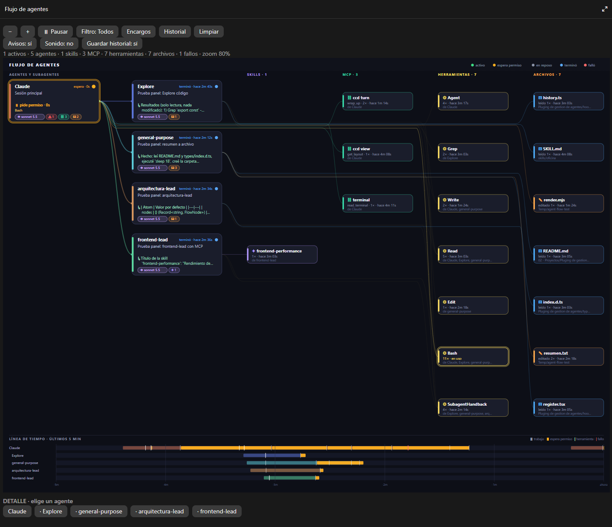
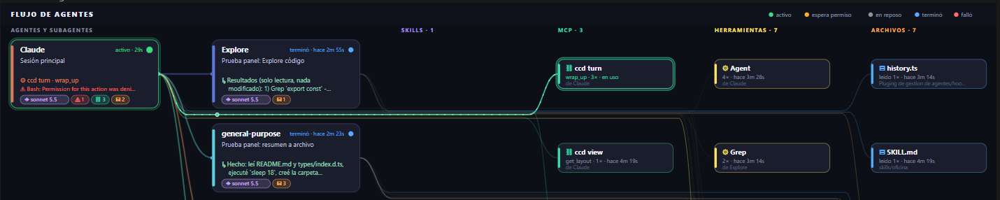

# agent-flow

Panel informativo en vivo para Claude Code (escritorio y terminal): muestra qué agente está activo, de quién cuelga cada subagente, qué skills, MCP, herramientas y archivos usa, y las líneas de flujo entre ellos.

- Las conexiones se mantienen hasta 5 minutos de inactividad.
- Escribe `/flow` para abrir el panel.
- En Claude Desktop se dibuja como SVG; en la terminal, como árbol de texto.



## Cómo se lee el panel

El gráfico va de izquierda a derecha: primero los agentes y, a la derecha, todo lo que usan.



**Columnas**

| Columna | Qué muestra |
|---|---|
| Agentes y subagentes | La sesión principal (`Claude`) y cada subagente que lanza, unidos por una línea al agente del que cuelgan |
| Skills | Las skills que ha cargado cada agente |
| MCP | Los servidores MCP usados y la última herramienta llamada |
| Herramientas | Las herramientas del propio motor (`Read`, `Bash`, `Grep`, `Write`…) con el número de usos y quién las usó |
| Archivos | Los archivos leídos (azul) o editados (naranja) y cuántas veces |

**Tarjeta de agente.** Cada una indica el tipo de agente, su estado, el encargo, la herramienta en uso o, al terminar, lo que respondió. Abajo lleva chips con el modelo y los contadores de skills, MCP, archivos y fallos.

**Estados** (el punto y el borde cambian de color):

| Color | Estado |
|---|---|
| Verde | activo |
| Ámbar | espera permiso: el agente está esperando que aceptes o rechaces una acción |
| Gris | en reposo |
| Azul | terminó |
| Rojo | falló |

**Líneas de flujo.** Brillan y llevan puntos en movimiento mientras el recurso se está usando (los últimos 20 s) y se atenúan después. Las que unen un agente con su subagente fluyen mientras el subagente trabaja, y al terminar vuelve un pulso al padre.

## Línea de tiempo

Debajo del gráfico hay una fila por agente con los últimos 5 minutos: cuándo trabajó, cuándo esperó permiso, cada llamada a una herramienta y cada fallo.


## Controles

- **− / +**: zoom del gráfico.
- **Pausar / Reanudar**: congela la vista para examinarla con calma; los avisos y el historial siguen su curso.
- **Filtro**: Todos, Activos o por departamento.
- **Encargos**: muestra el texto completo que recibió cada subagente.
- **Historial**: lista de todos los agentes de la sesión, también los que ya salieron del gráfico por inactividad.
- **Limpiar**: vacía el panel.
- **Avisos / Sonido**: aviso emergente (y un pitido opcional) cuando un subagente termina o falla.
- **Guardar historial**: escribe el historial en un archivo (ver Privacidad).
- **Detalle**: al elegir un agente en la lista inferior, se despliega todo lo suyo: encargo, herramientas, skills, MCP, archivos, errores y resultado.

## Privacidad

El panel guarda en el estado de la sesión el encargo de cada subagente (hasta 1200 caracteres) y su resultado. Con **Guardar historial** activado, que es el valor por defecto, además escribe un resumen por sesión en `~/.claude/agent-flow/history/<sesión>.json` con la descripción, el resultado, el último error y las rutas de los archivos de cada agente, pero no el encargo completo. Si no lo quieres, desactiva el botón **Guardar historial** en el panel.

## Requisitos

- **Claude Code 2.1.275 o posterior** (la instalación desde un repositorio de GitHub en un solo paso se añadió en esa versión). Probado con la versión 2.1.322 de la línea de comandos y con Claude Desktop.
- **Claude Desktop** para ver el gráfico SVG con las líneas de flujo. En la terminal el panel se ve como un árbol de texto.
- **Acceso a GitHub** para añadir el repositorio como fuente de plugins.
- No hace falta Node, npm ni compilar nada: el mod se carga tal cual.
- Probado en Windows 11 con PowerShell. El historial se guarda en `~/.claude/agent-flow/history/`, así que necesita poder escribir en esa carpeta (ver Privacidad).
- El **sonido** de los avisos depende de la terminal: no todas reproducen audio. Está desactivado por defecto.

## Instalación

### Desde GitHub (recomendado)

Dentro de Claude Code:

```
/plugin install agent-flow --marketplace AMG-Soulrak/Agent-Mod-for-Claude
```

O desde la terminal:

```
claude plugin install agent-flow --marketplace AMG-Soulrak/Agent-Mod-for-Claude
```

Reinicia la sesión y escribe `/flow`. El plugin se instala a nivel de usuario, así que se carga en todas tus sesiones.

Para actualizarlo cuando haya una versión nueva (hace falta reiniciar para aplicarla):

```
claude plugin update agent-flow
```

Para quitarlo:

```
claude plugin uninstall agent-flow
```

### Desde una copia local

Si prefieres instalar desde una copia de esta carpeta (por ejemplo, para probar cambios), crea un marketplace local con ella. En **PowerShell**, desde la carpeta del repositorio:

```powershell
New-Item -ItemType Directory -Force "$HOME\.claude\local-marketplace\.claude-plugin", "$HOME\.claude\local-marketplace\agent-flow" | Out-Null
Copy-Item -Recurse -Force ".claude-plugin", "hooks", "types", "LICENSE", "README.md" "$HOME\.claude\local-marketplace\agent-flow\"
Remove-Item -Recurse -Force "$HOME\.claude\local-marketplace\agent-flow\.claude-plugin\types" -ErrorAction SilentlyContinue
Set-Content -Encoding ascii "$HOME\.claude\local-marketplace\.claude-plugin\marketplace.json" '{"name":"local-mods","owner":{"name":"tu-nombre"},"plugins":[{"name":"agent-flow","source":"./agent-flow","description":"Panel en vivo de agentes, skills, MCP y archivos"}]}'
claude plugin marketplace add "$HOME\.claude\local-marketplace"
claude plugin install agent-flow@local-mods
```

Reinicia la sesión y escribe `/flow`. Esta forma instala una **copia**: tras cambiar el código, vuelve a ejecutar el segundo paso y luego `claude plugin update agent-flow@local-mods`.

### Comprobar la instalación

```
claude plugin list
```

Debe aparecer `agent-flow` como `enabled`.

## Licencia

MIT. Ver [LICENSE](LICENSE).
